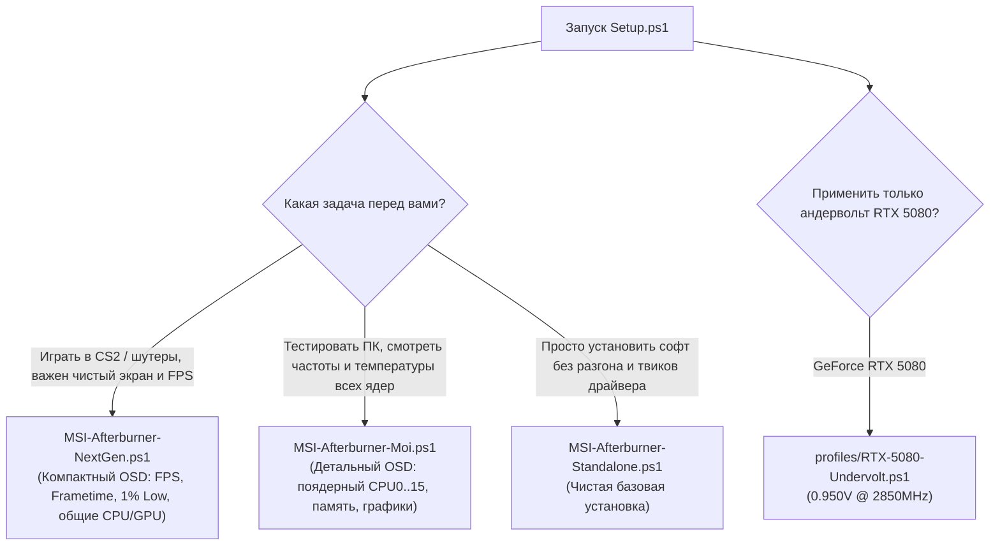

# ⚡ MSI Afterburner & RTSS Esports Suite

Профессиональный набор готовых конфигураций и скриптов автоматической установки **MSI Afterburner** и **RivaTuner Statistics Server (RTSS)** под соревновательные игры и бенчмарки от **Vektor010**.

---

## 🚀 Быстрый старт: Запуск в 1 клик

В корне репозитория находится интерактивный установщик — **`Setup.ps1`**.  
Запустите его через PowerShell от Администратора:

```powershell
powershell -ExecutionPolicy Bypass -File .\Setup.ps1
```

```
========================================================================
             MSI AFTERBURNER & RTSS AUTOMATED SETUP SUITE               
========================================================================
  [1] NextGen — Киберспортивный OSD (MSI-Afterburner-NextGen.ps1)
  [2] Moi — Детальный OSD для бенчмарков (MSI-Afterburner-Moi.ps1)
  [3] Standalone — Чистая базовая установка (MSI-Afterburner-Standalone.ps1)
  [4] Профиль андервольта: RTX 5080 (0.950V / 2850MHz)
  [T] Запустить тесты качества (Syntax.Tests.ps1)
  [Q] Выход
========================================================================
```

---

## 📦 3 Основных Твика: Чем они отличаются?

| Параметр | 🟢 `MSI-Afterburner-NextGen.ps1` | 🟡 `MSI-Afterburner-Moi.ps1` | ⚪ `MSI-Afterburner-Standalone.ps1` |
|---|---|---|---|
| **Название конфига** | **NextGen (Киберспорт)** | **Moi (Детальный / Бенчмарк)** | **Standalone (Чистый софт)** |
| **Для чего создан** | Соревновательные шутеры (CS2, Apex, Warzone, Valorant) | Тестирование железа, поиск троттлинга, замер стабильности | Чистая установка без разгона и без модификации драйверов |
| **Стиль OSD на экране** | **Компактный вертикальный стек**: только FPS, фреймтайм, 1% Low, 0.1% Low, общая температура и загрузка CPU/GPU | **Полная диагностика**: мониторинг частот, вольтажа и нагрева **каждого отдельного ядра CPU** (CPU0..CPU15), видеопамяти, кулеров, график фреймтайма | Базовый аккуратный оверлей |
| **Нагрузка на зрение** | **0% визуального шума**: радар, прицел, таймеры и чат свободны | Информационный центр для тестеров | Стандартный ненавязчивый вид |
| **Настройки GPU / Андервольт** | Включает профиль стабильного андервольта RTX 5080 (0.950V / 2850MHz) в Профиль 1 | Включает авторский профиль стабильного андервольта RTX 5080 (0.950V / 2850MHz) в Профиль 1 | **Не трогает частоты и кривые GPU** (подходит для абсолютно любой видеокарты) |
| **Твики драйвера NVIDIA** | Включает киберспортивный профиль через NPI (Unlimited шейдерный кэш, P-State 1, Threaded On) | Включает киберспортивный профиль драйвера NVIDIA | **Не трогает драйвер NVIDIA** |
| **Скрытие иконки RTSS в трее** | ✅ Да (`SingleTrayIconMode = 1`) | ✅ Да (`SingleTrayIconMode = 1`) | ✅ Да (`SingleTrayIconMode = 1`) |
| **Хоткей переключения OSD** | <kbd>Alt</kbd> + <kbd>1</kbd> | <kbd>Alt</kbd> + <kbd>1</kbd> | <kbd>Alt</kbd> + <kbd>1</kbd> |
| **Оверлей при старте игры** | Скрыт (`EnableOSD = 0`) | Скрыт (`EnableOSD = 0`) | Скрыт (`EnableOSD = 0`) |

---

## 🧭 Схема выбора конфигурации



---

## ⌨️ Горячие клавиши (Управление прямо в игре)

| Сочетание клавиш | Назначение | Поведение |
|---|---|---|
| **<kbd>Alt</kbd> + <kbd>1</kbd>** | **Включить / скрыть оверлей OSD** | По умолчанию оверлей не мешает и скрыт. Нажатие **Alt + 1** мгновенно включает или отключает показатели. Синхронизировано между Afterburner и RTSS. |
| **<kbd>Alt</kbd> + <kbd>F1</kbd>** | **Загрузить Профиль 1 (Андервольт)** | Холодная видеокарта, тихие вентиляторы, отсутствие сброса частот от перегрева. |
| **<kbd>Alt</kbd> + <kbd>F2</kbd>** | **Загрузить Профиль 2 (Разгон / Stock)** | Профиль предельной производительности. |

---

## 🛡️ Ключевые инженерные принципы

1. **Режим «Призрак» (`SingleTrayIconMode = 1`)**:
   * Синяя иконка RTSS (монитор с цифрой 60) **скрыта из системного трея Windows**.
   * Трей чистый — доступен только единый значок MSI Afterburner.
2. **Чистый экран при запуске игры (`EnableOSD = 0`)**:
   * При старте матча экран остается чистым. Оверлей активируется только по нажатию <kbd>Alt</kbd> + <kbd>1</kbd>.
3. **Идемпотентность и скорость (до 5 секунд)**:
   * Скрипт мгновенно определяет уже установленные компоненты. При повторном запуске пропускаются сетевые загрузки и повторные инсталляции.
4. **Динамическое определение GPU**:
   * Конфигурация видеокарты не привязана к одной строке: скрипт динамически связывает настройки с обнаруженным оборудованием (`VEN_10DE...`).
5. **Безопасность и автоматические бэкапы**:
   * Перед любым изменением конфигураций создается полная резервная копия в папку `Profiles\Backup_ГГГГММДД_ЧЧММСС`.
6. **Полный аудит и тесты качества (18 проверок из 18)**:
   * Все скрипты соответствуют строгому стандарту PowerShell AST (0 синтаксических ошибок) и кодировке UTF-8 с BOM.

---

## 📂 Структура репозитория

```
msi-afterburner-rtss/
├── Setup.ps1                       # Главное интерактивное меню (запуск в 1 клик)
├── MSI-Afterburner-NextGen.ps1     # Твик 1: NextGen (компактный киберспортивный OSD)
├── MSI-Afterburner-Moi.ps1         # Твик 2: Moi (детальный OSD, поядерный CPU0..15)
├── MSI-Afterburner-Standalone.ps1  # Твик 3: Standalone (чистый софт без разгона)
├── README.md                       # Главное руководство пользователя
├── AGENTS.md                       # Инструкции для ИИ-агентов
├── LICENSE                         # Лицензия
├── profiles/                       # Профили видеокарты
│   └── RTX-5080-Undervolt.ps1      # Профиль андервольта RTX 5080 (0.950V / 2850MHz)
├── tools/                          # Низколатентные утилиты NVIDIA
│   ├── nvidiaProfileInspector.exe
│   ├── nvidiaProfileInspector.exe.config
│   ├── Reference.xml
│   └── NV-Esports-Ultimate.nip     # Твик драйвера NVIDIA
├── tests/                          # Тестовый комплекс качества
│   └── Syntax.Tests.ps1            # Тесты AST-парсера, BOM-заголовков и конфигураций
└── docs/                           # Дополнительная документация
    ├── ARCHITECTURE.md             # Карта памяти процессов, IPC и хуки RTSS
    ├── CHANGELOG.md                # История версий
    └── KNOWN_ISSUES.md             # Ограничения и пути их обхода
```

---

## 🧪 Запуск автоматических тестов

Для проверки целостности всех скриптов и профилей выполните:

```powershell
powershell -ExecutionPolicy Bypass -File .\tests\Syntax.Tests.ps1
```

Результат:
```
=== ApexTuner Automated Test Suite ===
Discovered 7 PowerShell scripts for evaluation.

Test Group 1: Abstract Syntax Tree (AST) Validation
  [PASS] AST Syntax: MSI-Afterburner-Moi.ps1
  [PASS] AST Syntax: MSI-Afterburner-NextGen.ps1
  [PASS] AST Syntax: MSI-Afterburner-Standalone.ps1
  [PASS] AST Syntax: Setup.ps1
  [PASS] AST Syntax: RTX-3060-Undervolt.ps1
  [PASS] AST Syntax: RTX-5080-Undervolt.ps1
  [PASS] AST Syntax: Syntax.Tests.ps1

Test Group 2: UTF-8 BOM Encoding Integrity
  [PASS] UTF-8 BOM Header: MSI-Afterburner-Moi.ps1
  [PASS] UTF-8 BOM Header: MSI-Afterburner-NextGen.ps1
  [PASS] UTF-8 BOM Header: MSI-Afterburner-Standalone.ps1
  [PASS] UTF-8 BOM Header: Setup.ps1
  [PASS] UTF-8 BOM Header: RTX-3060-Undervolt.ps1
  [PASS] UTF-8 BOM Header: RTX-5080-Undervolt.ps1
  [PASS] UTF-8 BOM Header: Syntax.Tests.ps1

Test Group 3: Live Configuration Contracts
  [PASS] MSIAfterburner.cfg contains SingleTrayIconMode=1
  [PASS] MSIAfterburner.cfg contains EnableServer=1
  [PASS] MSIAfterburner.cfg contains OSDToggleHotkey=00040031h
  [PASS] HotkeyHandler.cfg contains OSDToggleHotkey=00040031

==================================================
Test Results: Total: 18 | Passed: 18 | Failed: 0
==================================================
```
