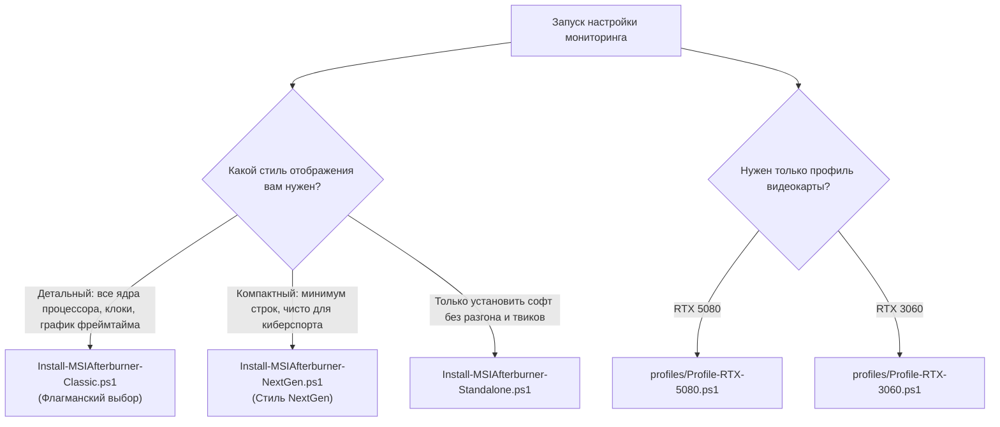

# ⚡ MSI Afterburner & RTSS Automation & Tuning Suite

Отдельный специализированный репозиторий для автоматической установки, настройки «под ключ» и киберспортивной оптимизации **MSI Afterburner** и **RivaTuner Statistics Server (RTSS)**.

---

## 🎯 Быстрый старт (Что запустить новичку?)

| Ваша цель | Рекомендуемый файл | Что делает |
|---|---|---|
| **Хочу всё настроить в 1 клик (рекомендуется)** | 🟢 **`Install-MSIAfterburner-Classic.ps1`** | Полная установка софта, детальный классический оверлей (ядра CPU0–CPU7, частоты, температуры, 1% Low), разгон/андервольт RTX 5080, твик драйвера NVIDIA, режим скрытого трея и хоткей Alt+1. |
| **Хочу минималистичный экран без лишних цифр** | 🔵 **`Install-MSIAfterburner-NextGen.ps1`** | Компактный вертикальный оверлей NextGen (только FPS, фреймтайм, общая загрузка). |
| **Только софт мониторинга (без профиля видеокарты)** | ⚪ **`Install-MSIAfterburner-Standalone.ps1`** | Чистая установка Afterburner и RTSS без вмешательства в драйверы и разгон. |
| **Применить андервольт для RTX 5080** | 🟡 **`profiles/Profile-RTX-5080.ps1`** | Накатывает проверенную курву андервольта для RTX 5080 без переустановки софта. |
| **Применить андервольт для RTX 3060** | 🟠 **`profiles/Profile-RTX-3060.ps1`** | Накатывает проверенную курву андервольта для RTX 3060. |

---

## 🧭 Интерактивная схема выбора



---

## ⌨️ Горячие клавиши (Управление прямо в играх)

| Сочетание клавиш | Назначение | Как это работает |
|---|---|---|
| **<kbd>Alt</kbd> + <kbd>1</kbd>** | **Включить / скрыть оверлей FPS** | По умолчанию экран в игре чистый. Нажали **Alt + 1** — оверлей появился. Нажали ещё раз — исчез. Синхронизировано между Afterburner и RTSS. |
| **<kbd>Alt</kbd> + <kbd>F1</kbd>** | **Загрузить Профиль 1 (Андервольт)** | Энергоэффективный режим с пониженным нагревом, стабильными частотами и тихой работой вертушек. |
| **<kbd>Alt</kbd> + <kbd>F2</kbd>** | **Загрузить Профиль 2 (Разгон)** | Режим максимальной производительности для выжимания предельного FPS. |

---

## 🛡️ Ключевые инженерные преимущества этого установщика

1. **Режим «Призрак» (`SingleTrayIconMode = 1`)**:
   * Синяя иконка RTSS (монитор с цифрой 60) **не засоряет системный трей** Windows.
   * В трее видна только одна иконка MSI Afterburner.
   * Оверлей в играх скрыт по умолчанию (`EnableOSD = 0`).
2. **Молниеносная скорость (Идемпотентность)**:
   * Если программы уже установлены, скрипт не тратит трафик и время на повторную загрузку 50 МБ и установку.
   * Повторный запуск скрипта выполняется **всего за 4–5 секунд** вместо 60 секунд.
3. **Безопасность и автоматические бэкапы**:
   * Перед любым изменением конфигураций скрипт создаёт бэкап в папке `Backup_ГГГГММДД_ЧЧММСС`.
   * Штатное завершение процессов (`CloseMainWindow`) перед записью исключает повреждение файлов.
4. **Профессиональное логирование**:
   * Подробные отчёты с таймингами каждого шага сохраняются в папку [`Logs/`](./Logs).
5. **Динамический поиск видеокарты**:
   * Скрипт сам определяет PCI-ID установленной карты (`VEN_10DE...cfg`), предотвращая сбои на картах разных брендов (Palit, ASUS, MSI, Gigabyte, FE).

---

## 📁 Структура репозитория

```
msi-afterburner-rtss/
├── Install-MSIAfterburner-Classic.ps1    # Основной флагманский скрипт (детальный стиль)
├── Install-MSIAfterburner-NextGen.ps1    # Компактный киберспортивный скрипт
├── Install-MSIAfterburner-Standalone.ps1 # Модульный установщик чистого софта
├── README.md                            # Данное руководство
├── profiles/                            # Отдельные профили курвы и разгона
│   ├── Profile-RTX-5080.ps1             # Андервольт и частоты для GeForce RTX 5080
│   └── Profile-RTX-3060.ps1             # Андервольт и частоты для GeForce RTX 3060
├── tools/                               # Вспомогательные киберспортивные утилиты
│   ├── nvidiaProfileInspector.exe       # Портативный инспектор профилей NVIDIA
│   ├── nvidiaProfileInspector.exe.config
│   ├── Reference.xml
│   └── NV-Esports-Ultimate.nip          # Низколатентный профиль драйвера NVIDIA
└── Logs/                                # Сессионные логи аудита и проверок
```

---

## 🚀 Пошаговая инструкция запуска

1. Откройте папку `msi-afterburner-rtss` в Проводнике.
2. Кликните правой кнопкой мыши по **`Install-MSIAfterburner-Classic.ps1`**.
3. Выберите пункт **«Выполнить с помощью PowerShell»**.
4. При запросе прав администратора нажмите **«Да»**.
5. Дождитесь появления зелёного итогового отчёта:
   ```
   ==========================================================
                   ИТОГОВЫЙ ОТЧЁТ УСТАНОВКИ                  
   ==========================================================
     Статус MSI Afterburner : Уже установлен / Настроен
     Процесс Afterburner    : Работает
     Статус RTSS            : Уже установлен / Настроен
     Процесс RTSS           : Работает в фоне
     Иконка RTSS в трее     : СКРЫТА (SingleTrayIconMode = 1)
     Оверлей по умолчанию   : СКРЫТ (EnableOSD = 0)
     Горячая клавиша OSD    : Alt + 1 (Синхронизировано)
     Общее время выполнения : ~4.8 сек
   ==========================================================
   ```

---

## ❓ Часто задаваемые вопросы (FAQ)

<details>
<summary><b>Куда делся значок RTSS в трее?</b></summary>
Он скрыт штатной настройкой Afterburner <code>SingleTrayIconMode = 1</code>, чтобы панель задач оставалась чистой. Сам сервер RTSS работает в фоне и ждет нажатия клавиши <b>Alt + 1</b>. Если нужно открыть настройки RTSS вручную — запустите его через ярлык меню «Пуск».
</details>

<details>
<summary><b>Почему при старте игры нет оверлея?</b></summary>
Экран чистый по умолчанию (<code>EnableOSD = 0</code>), чтобы не мешать погружению и не закрывать элементы интерфейса. Чтобы включить оверлей — нажмите <b>Alt + 1</b> в любой момент матча.
</details>

<details>
<summary><b>Что делать, если у меня другая видеокарта (не RTX 5080)?</b></summary>
Скрипт настроит Afterburner и RTSS под любую видеокарту (мониторинг, скрытый трей, Alt+1). Разгон можно настроить вручную в Afterburner или запустить соответствующий профиль из папки <code>profiles/</code> (например, <code>Profile-RTX-3060.ps1</code>).
</details>
