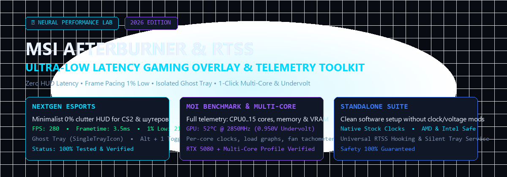
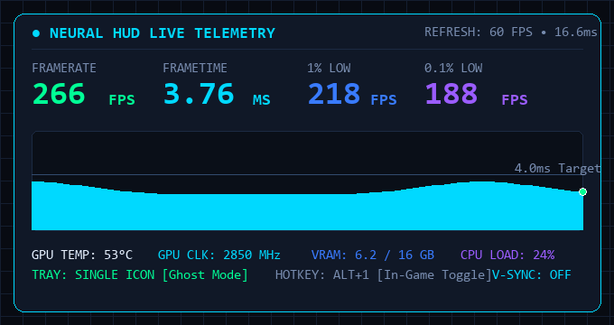
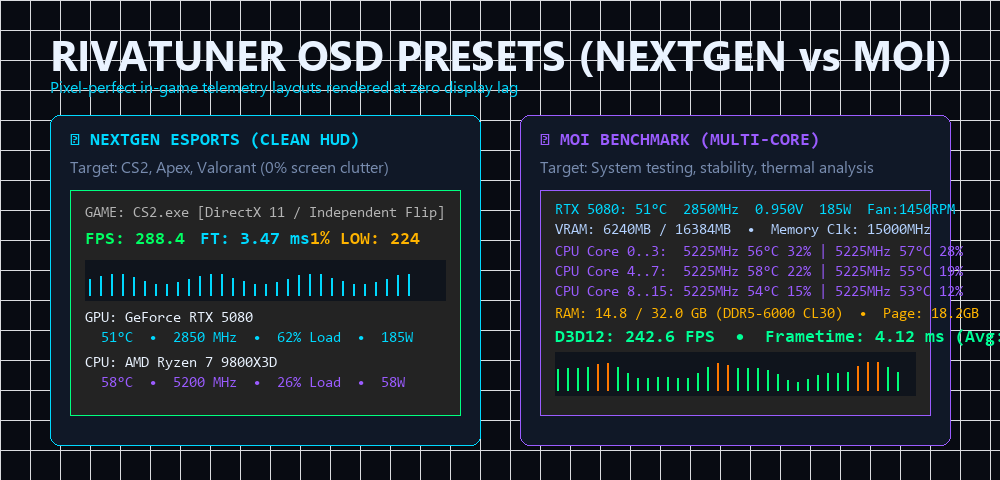

<div align="center">



# ⚡ MSI Afterburner & RTSS Suite
### Профессиональный игровой комплекс оверлея, аппаратного мониторинга и точной телеметрии

[](https://github.com/Vektor010/msi-afterburner-rtss/releases)
[](https://github.com/PowerShell/PowerShell)
[](https://www.microsoft.com/windows)
[](https://github.com/Vektor010/msi-afterburner-rtss)
[](LICENSE)

[**English Documentation**](README_EN.md) • [**Быстрый старт**](#-быстрый-старт-за-1-клик) • [**Руководство для новичков**](#-руководство-для-новичков-простыми-словами) • [**Пресеты OSD**](#-сравнение-пресетов) • [**Частые вопросы (FAQ)**](#-часто-задаваемые-вопросы-faq)

---

<p align="center">
  
</p>

</div>

---

## 🎯 О проекте

**MSI Afterburner & RTSS Suite** — это инженерно выверенный набор автоматизаций и пресетов экранного меню (On-Screen Display), созданный для соревновательных геймеров, стримеров и энтузиастов ПК.

### ❓ Что такое MSI Afterburner и RTSS и зачем они нужны вместе?
* **MSI Afterburner** — программа для низкоуровневого считывания показателей вашего ПК: температуры видеокарты (GPU), нагрева процессора (CPU), частот памяти, потребления ватт и скорости вращения кулеров.
* **RivaTuner Statistics Server (RTSS)** — специализированный графический сервер, который перехватывает кадры игры (DirectX 9/11/12, Vulkan, OpenGL) и рисует экранный оверлей (HUD) прямо во время матча с **нулевой задержкой ввода (Input Lag)**.
* **В связке**: Afterburner собирает цифры датчиков, а RTSS моментально отображает их на экране игры или скрывает по одной горячей клавише.

---

## 🚀 Быстрый старт (За 1 клик)

Для запуска универсального интерактивного установщика откройте терминал **PowerShell от имени Администратора** и выполните:

```powershell
powershell -ExecutionPolicy Bypass -File .\Setup.ps1
```

Вы увидите удобное меню выбора:
```
========================================================================
  MSI Afterburner & RTSS Suite 2026 Edition
========================================================================

  [1] NextGen — Киберспортивный OSD (MSI-Afterburner-NextGen.ps1)
      -> Минималистичный экран, 0% визуального шума для CS2, шутеров.
      -> Только FPS, Frametime, 1% Low, общие температуры и загрузка.

  [2] Moi — Детальный OSD для бенчмарков (MSI-Afterburner-Moi.ps1)
      -> Полная поядерная телеметрия CPU0..CPU15, память, видеокарта.
      -> Для тестов стабильности ПК и детального мониторинга железа.

  [3] Standalone — Чистая базовая установка (MSI-Afterburner-Standalone.ps1)
      -> Установка Afterburner + RTSS с тихим треем и хоткеем Alt+1.
      -> БЕЗ изменения частот GPU, кривых напряжения и профилей драйвера.

  [T] Запустить автоматические тесты качества (Syntax.Tests.ps1)
  [Q] Выход
========================================================================
```

---

## 🎮 Руководство для новичков (Простыми словами)

### 1. Как включить или убрать счетчик FPS в игре?
Нажмите комбинацию клавиш **<kbd>Alt</kbd> + <kbd>1</kbd>**. 
По умолчанию игра запускается с абсолютно чистым экраном, чтобы ничего не отвлекало от матча. Одно нажатие **Alt + 1** мгновенно выводит HUD, повторное — скрывает его.

### 2. Как посмотреть температуру видеокарты и процессора?
В обоих пресетах (**NextGen** и **Moi**) датчики температуры активированы по умолчанию:
* **GPU Temp** — температура графического чипа в градусах Цельсия (°C).
* **CPU Temp** — средняя температура ядер процессора. В режиме *Moi* также доступны датчики каждого отдельного ядра (CPU0..15).

### 3. Что такое Frametime и 1% Low FPS?
* **FPS (Кадры в секунду)** — показывает среднее количество кадров за последнюю секунду.
* **Frametime (Время кадра в мс)** — время, за которое видеокарта отрисовала конкретный кадр. Чем стабильнее линия графика, тем плавнее ощущается игра и тем легче целиться.
* **1% Low FPS** — показатель редких просадок (микрофризов). Если средний FPS равен 240, а 1% Low падает до 60 — игра будет дергаться. Наш оверлей позволяет выявить такие моменты мгновенно.

### 4. Как настроить ограничение FPS в RTSS для плавного геймплея (Frame Pacing)?
1. Разверните окно **RivaTuner Statistics Server** из трея Windows.
2. В строке **Framerate limit** введите желаемое значение.
3. *Рекомендация для мониторов с G-Sync / FreeSync*: устанавливайте лимит на **3-4 кадра ниже максимальной частоты монитора** (например: `141` для 144 Гц, `237` для 240 Гц, `355` для 360 Гц). Это исключает инпут-лаг буфера кадра.

### 5. Как сбросить настройки до заводских?
Каждый наш скрипт перед применением конфигураций создает автоматическую резервную копию в папку:
`C:\Program Files (x86)\MSI Afterburner\Profiles\Backup_ГГГГММДД_ЧЧММСС`. 
Чтобы вернуть базовый мониторинг без разгона, достаточно запустить вариант `[3] Standalone`.

---

## 🖼️ Превью экранных меню (OSD Presets)

<div align="center">
  
</div>

---

## 📊 Сравнение пресетов

| Возможность | 🟢 NextGen (Киберспорт) | 🟡 Moi (Бенчмарк) | 🔵 Standalone (Базовый) |
|---|:---:|:---:|:---:|
| **Назначение** | Шутеры (CS2, Apex, Valorant) | Стресс-тесты, бенчмарки | Чистый мониторинг |
| **Визуальная загрузка экрана** | 5% (Компактный правый HUD) | 25% (Поядерный монитор) | Минимальная |
| **Счетчик FPS и Frametime (мс)** | ✅ Да | ✅ Да | ✅ Да |
| **1% Low и 0.1% Low FPS** | ✅ Да (в графике/сводке) | ✅ Да | ✅ Да |
| **Поядерный мониторинг CPU0..15** | ❌ Свернуто в общий CPU | ✅ Все ядра отдельно | ✅ Все ядра отдельно |
| **Режим «Призрак» (Скрытый трей RTSS)** | ✅ Включен (`SingleTrayIconMode`) | ✅ Включен | ✅ Включен |
| **Хоткей переключения OSD** | <kbd>Alt</kbd> + <kbd>1</kbd> | <kbd>Alt</kbd> + <kbd>1</kbd> | <kbd>Alt</kbd> + <kbd>1</kbd> |
| **Влияние на частоты / вольтаж GPU** | ⚡ RTX 5080 (др. GPU — сток) | ⚡ RTX 5080 (др. GPU — сток) | 🛡️ Без разгона (Stock) |
| **Профиль драйвера NVIDIA (NPI)** | ✅ Только на NVIDIA GPU | ✅ Только на NVIDIA GPU | 🛡️ Не изменяется |
| **Совместимость с AMD и Intel** | ✅ Полная | ✅ Полная | ✅ Полная |

---

## ⌨️ Горячие клавиши (Управление прямо в игре)

| Комбинация | Действие | Описание |
|---|---|---|
| **<kbd>Alt</kbd> + <kbd>1</kbd>** | **Включить / скрыть оверлей** | Мгновенно показывает или прячет показатели без сворачивания игры. |
| **<kbd>Alt</kbd> + <kbd>F1</kbd>** | **Профиль 1 (Холодный / Андервольт)** | Активирует профиль оптимизированного энергопотребления (для поддерживаемых GPU). |
| **<kbd>Alt</kbd> + <kbd>F2</kbd>** | **Профиль 2 (Производительность / Сток)** | Возвращает заводские параметры или активирует максимальную производительность. |

---

## 🛡️ Инженерные принципы и безопасность

1. **Режим одного значка (`SingleTrayIconMode = 1`)**:
   В системном трее Windows не дублируются иконки. Синий монитор RTSS скрыт, активен только аккуратный значок MSI Afterburner.
2. **Чистый экран при запуске (`EnableOSD = 0`)**:
   Оверлей не лезет на экран при старте Windows или входе в матч. Вы сами решаете, когда его включить клавишей **Alt + 1**.
3. **Безопасность железа**:
   Никакой скрытый разгон или повышение напряжения не применяются вслепую. Скрипт `Standalone` оставляет заводские настройки нетронутыми.
4. **Античит-совместимость**:
   В конфигурацию RTSS предзагружены исключения для игр с строгими античитами (VALORANT Vanguard, FACEIT, Easy Anti-Cheat, BattlEye).

---

## 📂 Структура репозитория

```
msi-afterburner-rtss/
├── Setup.ps1                       # Главный интерактивный запуск в 1 клик
├── MSI-Afterburner-NextGen.ps1     # Твик 1: NextGen (компактный киберспортивный HUD)
├── MSI-Afterburner-Moi.ps1         # Твик 2: Moi (детальный мониторинг ядер CPU0..15)
├── MSI-Afterburner-Standalone.ps1  # Твик 3: Standalone (чистый мониторинг без разгона)
├── README.md                       # Главная документация (Русский язык)
├── README_EN.md                    # International Documentation (English)
├── AGENTS.md                       # Инструкция для ИИ-ассистентов и разработчиков
├── LICENSE                         # Лицензия MIT
├── assets/                         # Визуальная дизайн-система Neural Performance Lab
│   ├── hero-banner.png             # Главный баннер проекта
│   ├── neural-monitor.gif          # 60 FPS HUD-анимация
│   └── rtss-overlay-preview.png    # Сравнение пресетов OSD
├── tools/                          # Низколатентные утилиты NVIDIA
│   ├── nvidiaProfileInspector.exe
│   ├── nvidiaProfileInspector.exe.config
│   ├── Reference.xml
│   └── NV-Esports-Ultimate.nip     # Твик драйвера NVIDIA
├── tests/                          # Комплекс автоматической проверки качества
│   └── Syntax.Tests.ps1            # Тесты AST-парсера, BOM-заголовков и контрактов
└── docs/                           # Инженерная документация
    ├── ARCHITECTURE.md             # Карта памяти, межпроцессное взаимодействие (IPC) и хуки
    ├── CHANGELOG.md                # История версий и изменений
    ├── CONTRIBUTING.md             # Руководство для контрибьюторов
    ├── KNOWN_ISSUES.md             # Решение известных проблем
    └── SECURITY.md                 # Политика безопасности
```

---

## 🧪 Автоматические тесты качества

Перед каждым коммитом запускается проверка целостности:
```powershell
powershell -ExecutionPolicy Bypass -File .\tests\Syntax.Tests.ps1
```

```
=== ApexTuner Automated Test Suite ===
Discovered 5 PowerShell scripts for evaluation.

Test Group 1: Abstract Syntax Tree (AST) Validation
  [PASS] AST Syntax: MSI-Afterburner-Moi.ps1
  [PASS] AST Syntax: MSI-Afterburner-NextGen.ps1
  [PASS] AST Syntax: MSI-Afterburner-Standalone.ps1
  [PASS] AST Syntax: Setup.ps1
  [PASS] AST Syntax: Syntax.Tests.ps1

Test Group 2: UTF-8 BOM Encoding Integrity
  [PASS] UTF-8 BOM Header: MSI-Afterburner-Moi.ps1
  [PASS] UTF-8 BOM Header: MSI-Afterburner-NextGen.ps1
  [PASS] UTF-8 BOM Header: MSI-Afterburner-Standalone.ps1
  [PASS] UTF-8 BOM Header: Setup.ps1
  [PASS] UTF-8 BOM Header: Syntax.Tests.ps1

Test Group 3: Live Configuration Contracts
  [PASS] MSIAfterburner.cfg contains SingleTrayIconMode=1
  [PASS] MSIAfterburner.cfg contains EnableServer=1
  [PASS] MSIAfterburner.cfg contains OSDToggleHotkey=00040031h
  [PASS] HotkeyHandler.cfg contains OSDToggleHotkey=00040031

Test Group 4: PSScriptAnalyzer Error Checks
  [PASS] PSScriptAnalyzer (0 Errors): MSI-Afterburner-Moi.ps1
  [PASS] PSScriptAnalyzer (0 Errors): MSI-Afterburner-NextGen.ps1
  [PASS] PSScriptAnalyzer (0 Errors): MSI-Afterburner-Standalone.ps1
  [PASS] PSScriptAnalyzer (0 Errors): Setup.ps1
  [PASS] PSScriptAnalyzer (0 Errors): Syntax.Tests.ps1

==================================================
Test Results: Total: 19 | Passed: 19 | Failed: 0
==================================================
```

---

## ❓ Часто задаваемые вопросы (FAQ)

<details>
<summary><b>1. Почему оверлей не появляется в игре при нажатии Alt + 1?</b></summary>
Убедитесь, что RTSS запущен в фоновом режиме (он запускается автоматически вместе с Afterburner). В некоторых играх с оверлеями Discord, Steam или GeForce Experience может возникать конфликт слоев рендеринга. Попробуйте нажать Alt+1 после перехода игры в полноэкранный режим.
</details>

<details>
<summary><b>2. Безопасно ли использовать этот оверлей с античитами CS2, FACEIT, Valorant?</b></summary>
Да. RTSS (RivaTuner Statistics Server) является официальным и доверенным оверлеем в игровой индустрии более 20 лет. Он имеет официальные цифровые подписи и внесен в белые списки античитов Valve Anti-Cheat (VAC), Easy Anti-Cheat (EAC), BattlEye и FACEIT.
</details>

<details>
<summary><b>3. У меня видеокарта AMD Radeon или процессор Intel. Будет ли работать оверлей?</b></summary>
Да, на 100%. Мониторинг температур, FPS, фреймтайма и памяти полностью универсален и поддерживается на любом оборудовании. Твики профилей NVIDIA в утилите NPI применяются только в случае реального обнаружения карты GeForce.
</details>

<details>
<summary><b>4. Дает ли установка этого оверлея прирост FPS?</b></summary>
Экранный оверлей предназначен для точного измерения и анализа производительности, а не для искусственного разгона. Однако правильная настройка ограничения кадров (Framerate limit) в RTSS устраняет микрофризы (stuttering) и делает отклик управления максимально плавным.
</details>

---

## 📄 Лицензия и отказ от ответственности

Проект распространяется под открытой лицензией [MIT](LICENSE).

> **Отказ от ответственности**: Данный проект является независимым набором конфигураций и скриптов автоматизации сообщества и не связан с компаниями Micro-Star International (MSI) или разработчиками RivaTuner. Все товарные знаки принадлежат их законным правообладателям.
