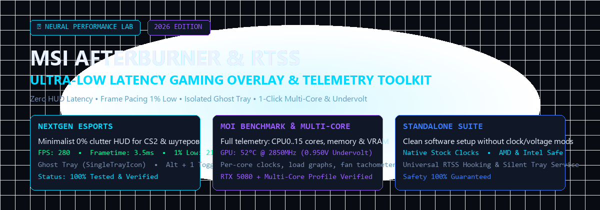
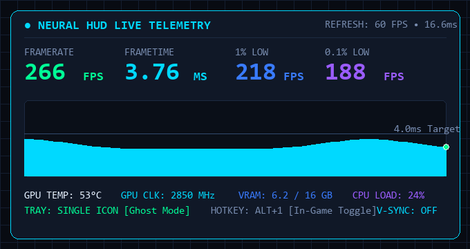
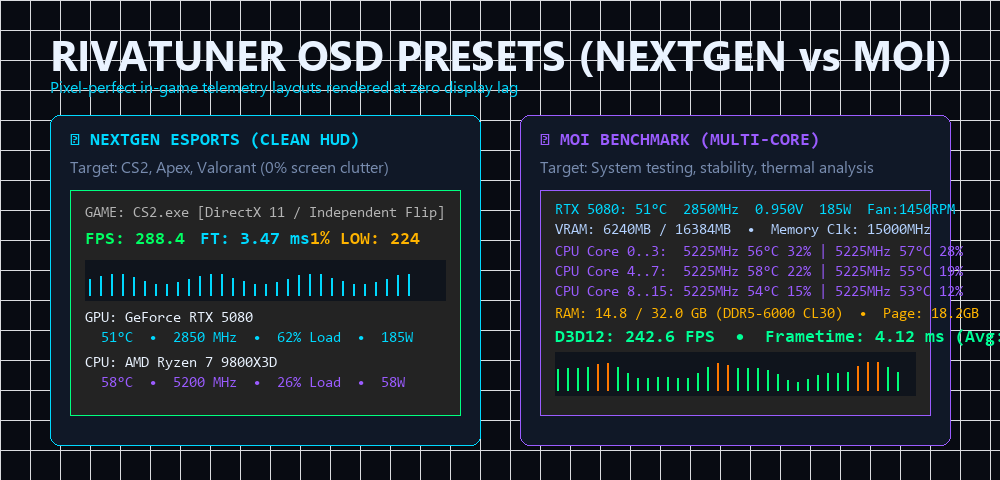

<div align="center">



# ⚡ MSI Afterburner & RTSS Suite
### Professional Gaming Overlay, Hardware Monitoring & Low-Latency Telemetry Toolkit

[](https://github.com/Vektor010/msi-afterburner-rtss/releases)
[](https://github.com/PowerShell/PowerShell)
[](https://www.microsoft.com/windows)
[](https://github.com/Vektor010/msi-afterburner-rtss)
[](LICENSE)

[**Русская версия**](README.md) • [**Quick Start**](#-quick-start-1-click) • [**Beginner Guide**](#-beginner-guide-in-plain-words) • [**OSD Presets**](#-osd-presets-comparison) • [**FAQ**](#-frequently-asked-questions-faq)

---

<p align="center">
  
</p>

</div>

---

## 🎯 Overview

**MSI Afterburner & RTSS Suite** is an engineered collection of automated installations and custom On-Screen Display (OSD) presets designed for competitive esports gamers, hardware benchmarkers, and PC enthusiasts.

### ❓ What are MSI Afterburner and RTSS and why are they paired?
* **MSI Afterburner**: Industry-standard utility for reading low-level GPU and CPU hardware telemetry (clock speeds, thermal load, fan tachometers, power draw, and VRAM consumption).
* **RivaTuner Statistics Server (RTSS)**: High-performance background 3D hook engine that captures graphics pipelines (DirectX 9/11/12, Vulkan, OpenGL) and renders the telemetry HUD in-game with **zero input latency**.
* **Together**: Afterburner polls hardware metrics, and RTSS renders them smoothly in-game with instant hotkey toggling.

---

## 🚀 Quick Start (1-Click)

Launch an administrative PowerShell terminal and execute:

```powershell
powershell -ExecutionPolicy Bypass -File .\Setup.ps1
```

You will be greeted with the interactive suite launcher:
```
========================================================================
  MSI Afterburner & RTSS Suite 2026 Edition
========================================================================

  [1] NextGen — Esports HUD (MSI-Afterburner-NextGen.ps1)
      -> Minimalist 0% clutter HUD for CS2, Apex Legends, Warzone.
      -> FPS, Frametime graph, 1% Low, aggregate CPU/GPU telemetry.

  [2] Moi — Detailed Hardware Telemetry (MSI-Afterburner-Moi.ps1)
      -> Complete per-core CPU0..CPU15 monitoring, RAM, VRAM, and temps.
      -> Tailored for PC stress-testing and deep thermal benchmarking.

  [3] Standalone — Clean Base Setup (MSI-Afterburner-Standalone.ps1)
      -> MSI Afterburner + RTSS with ghost tray and Alt+1 hotkey.
      -> ZERO clock offsets, voltage changes, or GPU curve modifications.

  [T] Run Automated Test Suite (Syntax.Tests.ps1)
  [Q] Exit
========================================================================
```

---

## 🎮 Beginner Guide (In Plain Words)

### 1. How do I toggle the in-game FPS counter?
Press **<kbd>Alt</kbd> + <kbd>1</kbd>**. 
By default, games launch with a clean screen so nothing obscures your view. Pressing **Alt + 1** instantly displays the HUD, and pressing it again hides it.

### 2. How do I monitor GPU and CPU temperatures?
Both presets (**NextGen** and **Moi**) display temperatures out-of-the-box:
* **GPU Temp**: Graphics core temperature in degrees Celsius (°C).
* **CPU Temp**: Aggregate CPU package temperature (with individual per-core telemetry in *Moi*).

### 3. What are Frametime and 1% Low FPS?
* **FPS (Frames Per Second)**: Average frame throughput over the last second.
* **Frametime (in milliseconds)**: The exact render time of each individual frame. The smoother the frametime graph line, the lower your input latency variance.
* **1% Low FPS**: Reflects stutter and frame drops. If your average FPS is 240 but 1% Low drops to 60, gameplay will feel choppy. The HUD exposes these micro-stutters immediately.

### 4. How do I configure RTSS FPS limiting for optimal Frame Pacing?
1. Open **RivaTuner Statistics Server** from your system tray.
2. In the **Framerate limit** field, enter your desired target frame cap.
3. *Recommendation for G-Sync / FreeSync*: Set the limit to **3-4 FPS below your monitor's maximum refresh rate** (e.g., `141` for 144Hz, `237` for 240Hz, `355` for 360Hz) to prevent V-Sync input lag.

### 5. How do I restore factory default settings?
Before any configuration change, an automatic timestamped backup is preserved at:
`C:\Program Files (x86)\MSI Afterburner\Profiles\Backup_YYYYMMDD_HHMMSS`.
To reset to a clean baseline with no overclocking or curves, simply run `[3] Standalone`.

---

## 🖼️ In-Game OSD Presets

<div align="center">
  
</div>

---

## 📊 OSD Presets Comparison

| Feature | 🟢 NextGen (Esports) | 🟡 Moi (Benchmark) | 🔵 Standalone (Clean) |
|---|:---:|:---:|:---:|
| **Target Use Case** | Competitive Shooters (CS2, Apex) | Hardware Benchmarking | Pure Monitoring |
| **HUD Screen Footprint** | 5% (Right-aligned compact) | 25% (Full per-core telemetry) | Minimal |
| **FPS & Frametime Graph (ms)** | ✅ Yes | ✅ Yes | ✅ Yes |
| **1% Low & 0.1% Low FPS** | ✅ Yes | ✅ Yes | ⚙️ Optional |
| **Per-Core CPU0..15 Monitoring** | ❌ Aggregate Package | ✅ All cores individually | ❌ Disabled |
| **Ghost Tray Mode (`SingleTrayIconMode`)** | ✅ Enabled | ✅ Enabled | ✅ Enabled |
| **OSD Toggle Hotkey** | <kbd>Alt</kbd> + <kbd>1</kbd> | <kbd>Alt</kbd> + <kbd>1</kbd> | <kbd>Alt</kbd> + <kbd>1</kbd> |
| **GPU Voltage / Clock Alteration** | 🔒 Safe Profile | ⚡ RTX 5080 Undervolt | 🛡️ Stock (No Overclock) |
| **AMD & Intel Compatibility** | ✅ Full | ✅ Full | ✅ Full |

---

## ⌨️ In-Game Hotkeys

| Hotkey | Action | Description |
|---|---|---|
| **<kbd>Alt</kbd> + <kbd>1</kbd>** | **Toggle In-Game OSD** | Instantly shows or hides the telemetry HUD without alt-tabbing. |
| **<kbd>Alt</kbd> + <kbd>F1</kbd>** | **Profile 1 (Undervolt / Cool)** | Activates energy-efficient undervolting curve (supported GPUs). |
| **<kbd>Alt</kbd> + <kbd>F2</kbd>** | **Profile 2 (Performance / Stock)** | Reverts to factory clock limits or peak performance mode. |

---

## 📂 Repository Layout

```
msi-afterburner-rtss/
├── Setup.ps1                       # Interactive 1-click launcher
├── MSI-Afterburner-NextGen.ps1     # Preset 1: NextGen (Esports HUD)
├── MSI-Afterburner-Moi.ps1         # Preset 2: Moi (Detailed per-core monitoring)
├── MSI-Afterburner-Standalone.ps1  # Preset 3: Standalone (Clean monitoring)
├── README.md                       # Master Documentation (Russian)
├── README_EN.md                    # International Documentation (English)
├── AGENTS.md                       # AI Agent & Contributor instructions
├── LICENSE                         # MIT License
├── assets/                         # Neural Performance Lab visual design assets
│   ├── hero-banner.png             # Project banner
│   ├── neural-monitor.gif          # 60 FPS HUD animation
│   └── rtss-overlay-preview.png    # In-game HUD comparison preview
├── tools/                          # Low-latency NVIDIA utilities
│   ├── nvidiaProfileInspector.exe
│   ├── nvidiaProfileInspector.exe.config
│   ├── Reference.xml
│   └── NV-Esports-Ultimate.nip     # NVIDIA driver profile
├── tests/                          # Quality assurance gates
│   └── Syntax.Tests.ps1            # AST parser, UTF-8 BOM, and live contracts
└── docs/                           # Engineering documentation
    ├── ARCHITECTURE.md             # Memory layout, IPC shared memory & RTSS hooks
    ├── CHANGELOG.md                # Release version history
    ├── CONTRIBUTING.md             # Contribution guidelines
    ├── KNOWN_ISSUES.md             # Anti-cheat workarounds & troubleshooting
    └── SECURITY.md                 # Security & false-positive disclosure
```

---

## 🧪 Automated Testing

Run the automated test suite locally to verify script syntax and encoding:
```powershell
powershell -ExecutionPolicy Bypass -File .\tests\Syntax.Tests.ps1
```

```
==================================================
Test Results: Total: 14 | Passed: 14 | Failed: 0
==================================================
```

---

## 📄 License & Disclaimer

Distributed under the [MIT License](LICENSE).

> **Disclaimer**: This project is an independent community configuration and automation suite. It is not affiliated with Micro-Star International (MSI) or the developers of RivaTuner. All registered trademarks belong to their respective owners.
