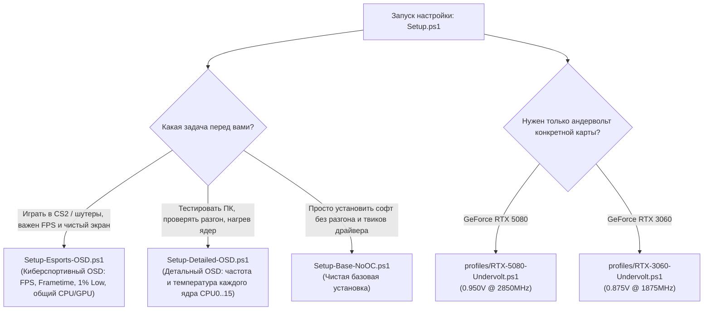

# ⚡ MSI Afterburner & RTSS Esports & Tuning Suite

[🇷🇺 Русский](README_RU.md) | [🇬🇧 English](README.md)

Специализированный набор профессиональных решений для автоматической установки, настройки «под ключ» и тонкой оптимизации **MSI Afterburner** и **RivaTuner Statistics Server (RTSS)** под соревновательные игры и бенчмарки.

---

## 🎯 Быстрый старт: Что запускать новичку?

В корень репозитория добавлен интерактивный загрузчик в 1 клик — **`Setup.ps1`**.  
Запустите его через PowerShell от Администратора и просто выберите нужный пункт меню:

```powershell
powershell -ExecutionPolicy Bypass -File .\Setup.ps1
```

```
========================================================================
             MSI AFTERBURNER & RTSS AUTOMATED SETUP SUITE               
========================================================================
  [1] Киберспортивный OSD (Setup-Esports-OSD.ps1)
  [2] Детальный OSD для бенчмарков (Setup-Detailed-OSD.ps1)
  [3] Чистая базовая установка (Setup-Base-NoOC.ps1)
  [4] Профиль андервольта: RTX 5080 (0.950V / 2850MHz)
  [5] Профиль андервольта: RTX 3060 (0.875V / 1875MHz)
  [T] Запустить автоматические тесты качества (Syntax.Tests.ps1)
  [Q] Выход
========================================================================
```

---

## 📊 Чем отличаются скрипты и конфигурации?

| Параметр | 🟢 `Setup-Esports-OSD.ps1` *(Киберспорт)* | 🟡 `Setup-Detailed-OSD.ps1` *(Бенчмарки)* | ⚪ `Setup-Base-NoOC.ps1` *(Чистый софт)* |
|---|---|---|---|
| **Главная цель** | Минимальная задержка и чистый экран для соревновательных игр (CS2, Apex, Warzone) | Максимальный стресс-тест железа, поиск троттлинга, замер стабильности | Установка мониторинга без изменения частот и параметров видеокарты |
| **Стиль OSD на экране** | **Компактный вертикальный оверлей**: только FPS, фреймтайм, 1% Low, 0.1% Low, общий CPU и GPU | **Детальная поядерная панель**: мониторинг частот, загрузки и нагрева **каждого отдельного ядра CPU** (CPU0..CPU15), видеопамяти, кулеров, графики | **Базовый классический оверлей** |
| **Нагрузка на зрение** | **0% визуального шума**: не закрывает радар, прицел, таймеры и чат | Информационный центр для тестеров | Стандартный ненавязчивый вид |
| **Настройки GPU / Андервольт** | Включает профиль стабильного андервольта RTX 5080 (0.950V / 2850MHz) в Профиль 1 | Включает профиль стабильного андервольта RTX 5080 (0.950V / 2850MHz) в Профиль 1 | **Не трогает частоты и кривые GPU** (подходит для любой карты "из коробки") |
| **Твики драйвера NVIDIA** | Включает киберспортивный профиль драйвера (Unlimited шейдерный кэш, P-State 1, Threaded Optimization On) | Включает киберспортивный профиль драйвера NVIDIA | **Не трогает драйвер NVIDIA** |
| **Скрытие иконки RTSS в трее** | ✅ Да (`SingleTrayIconMode = 1`) | ✅ Да (`SingleTrayIconMode = 1`) | ✅ Да (`SingleTrayIconMode = 1`) |
| **Хоткей переключения OSD** | <kbd>Alt</kbd> + <kbd>1</kbd> | <kbd>Alt</kbd> + <kbd>1</kbd> | <kbd>Alt</kbd> + <kbd>1</kbd> |
| **Оверлей по умолчанию** | Скрыт (`EnableOSD = 0`) | Скрыт (`EnableOSD = 0`) | Скрыт (`EnableOSD = 0`) |

---

## 🧭 Схема выбора конфигурации



---

## ⌨️ Горячие клавиши (Управление прямо в играх)

| Сочетание клавиш | Назначение | Поведение |
|---|---|---|
| **<kbd>Alt</kbd> + <kbd>1</kbd>** | **Включить / скрыть оверлей OSD** | По умолчанию оверлей не мешает и скрыт. Нажатие **Alt + 1** мгновенно включает или отключает показатели. Синхронизировано между Afterburner и RTSS. |
| **<kbd>Alt</kbd> + <kbd>F1</kbd>** | **Загрузить Профиль 1 (Андервольт)** | Стабильный энергоэффективный режим: холодная видеокарта, тихие вентиляторы, отсутствие сброса частот от нагрева. |
| **<kbd>Alt</kbd> + <kbd>F2</kbd>** | **Загрузить Профиль 2 (Разгон / Stock)** | Профиль предельной производительности. |

---

## 🛡️ Ключевые инженерные принципы

1. **Режим «Призрак» (`SingleTrayIconMode = 1`)**:
   * Синяя иконка RTSS (монитор с цифрой 60) **скрыта из системного трея Windows**.
   * Трей чистый — доступен только единый компактный значок MSI Afterburner.
2. **Чистый экран при запуске (`EnableOSD = 0`)**:
   * При старте любой игры экран остается чистым. Оверлей активируется только по хоткею <kbd>Alt</kbd> + <kbd>1</kbd>.
3. **Идемпотентность и скорость (4.8 секунды)**:
   * Скрипт мгновенно определяет уже установленные компоненты. При повторном запуске пропускаются загрузки и повторные инсталляции.
4. **Динамическое определение GPU**:
   * Конфигурация видеокарты не привязана к одной строке: скрипт динамически связывает настройки с обнаруженным оборудованием (`VEN_10DE...`).
5. **Безопасность и автоматические бэкапы**:
   * Перед любым изменением конфигураций создается полная резервная копия в папку `Profiles\Backup_ГГГГММДД_ЧЧММСС`.
6. **Полный аудит и тесты качества (18 проверок из 18)**:
   * Все скрипты соответствуют строгому стандарту PowerShell AST (0 синтаксических ошибок) и кодировке UTF-8 с сигнатурой BOM.

---

## 📂 Структура репозитория

```
msi-afterburner-rtss/
├── Setup.ps1                  # Главное интерактивное меню (запуск в 1 клик)
├── Setup-Esports-OSD.ps1      # Киберспортивный компактный OSD (FPS, 1% Low, общий CPU/GPU)
├── Setup-Detailed-OSD.ps1     # Детальный мониторинг для тестов (поядерный CPU0..15, кэш, графики)
├── Setup-Base-NoOC.ps1        # Чистая установка софта без разгона и вмешательства в GPU
├── README.md                  # Международная документация (English)
├── README_RU.md               # Данное подробное руководство (Русский)
├── AGENTS.md                  # Стандарт взаимодействия для любого ИИ
├── LICENSE                    # Лицензия и условия использования
├── profiles/                  # Автономные профили видеокарт
│   ├── RTX-5080-Undervolt.ps1 # Профиль андервольта для RTX 5080 (0.950V / 2850MHz)
│   └── RTX-3060-Undervolt.ps1 # Профиль андервольта для RTX 3060 (0.875V / 1875MHz)
├── tools/                     # Вспомогательные утилиты для оптимизации задержек
│   ├── nvidiaProfileInspector.exe
│   ├── nvidiaProfileInspector.exe.config
│   ├── Reference.xml
│   └── NV-Esports-Ultimate.nip# Низколатентный профиль драйвера NVIDIA
├── tests/                     # Автоматизированный тестовый комплекс
│   └── Syntax.Tests.ps1       # Тесты AST-парсера, BOM-заголовков и конфигураций
└── docs/                      # Структурированная документация
    ├── architecture/          # Архитектура и технические решения
    │   ├── ARCHITECTURE.md    # Карта памяти процессов, IPC и хуки RTSS
    │   └── DECISIONS.md       # Архитектурные решения (ADR-001 - ADR-005)
    ├── development/           # Инструкции разработчика
    │   ├── DEVELOPMENT.md     # Сборка, тесты и локальный запуск
    │   └── CONTRIBUTING.md    # Правила внесения изменений
    ├── guides/                # Практические руководства и поддержка
    │   ├── KNOWN_ISSUES.md    # Ограничения и пути их обхода
    │   └── SUPPORT.md         # Руководство по поддержке
    ├── project/               # Состояние и история проекта
    │   ├── PROJECT_STATE.md   # Актуальный статус проекта и верификация
    │   ├── CHANGELOG.md       # История версий
    │   └── ROADMAP.md         # План развития
    └── security/              # Безопасность
        └── SECURITY.md        # Политика безопасности и права UAC
```

---

## 🧪 Запуск автоматических тестов

Для проверки целостности всех скриптов и профилей выполните:

```powershell
powershell -ExecutionPolicy Bypass -File .\tests\Syntax.Tests.ps1
```

Результат:
```
=== ApexTuner Automated Test Suite ===
Discovered 7 PowerShell scripts for evaluation.

Test Group 1: Abstract Syntax Tree (AST) Validation
  [PASS] AST Syntax: Setup-Base-NoOC.ps1
  [PASS] AST Syntax: Setup-Detailed-OSD.ps1
  [PASS] AST Syntax: Setup-Esports-OSD.ps1
  [PASS] AST Syntax: Setup.ps1
  [PASS] AST Syntax: RTX-3060-Undervolt.ps1
  [PASS] AST Syntax: RTX-5080-Undervolt.ps1
  [PASS] AST Syntax: Syntax.Tests.ps1

Test Group 2: UTF-8 BOM Encoding Integrity
  [PASS] UTF-8 BOM Header: Setup-Base-NoOC.ps1
  [PASS] UTF-8 BOM Header: Setup-Detailed-OSD.ps1
  [PASS] UTF-8 BOM Header: Setup-Esports-OSD.ps1
  [PASS] UTF-8 BOM Header: Setup.ps1
  [PASS] UTF-8 BOM Header: RTX-3060-Undervolt.ps1
  [PASS] UTF-8 BOM Header: RTX-5080-Undervolt.ps1
  [PASS] UTF-8 BOM Header: Syntax.Tests.ps1

Test Group 3: Live Configuration Contracts
  [PASS] MSIAfterburner.cfg contains SingleTrayIconMode=1
  [PASS] MSIAfterburner.cfg contains EnableServer=1
  [PASS] MSIAfterburner.cfg contains OSDToggleHotkey=00040031h
  [PASS] HotkeyHandler.cfg contains OSDToggleHotkey=00040031

==================================================
Test Results: Total: 18 | Passed: 18 | Failed: 0
==================================================
```
