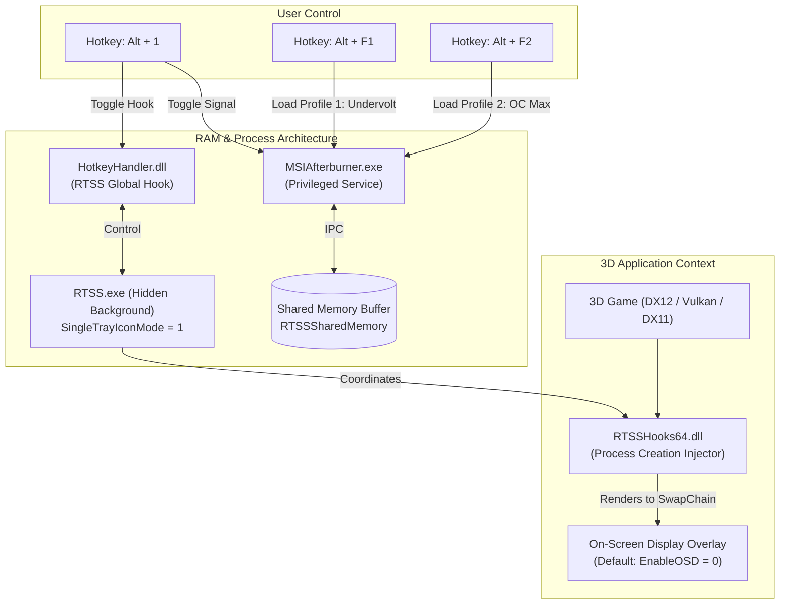
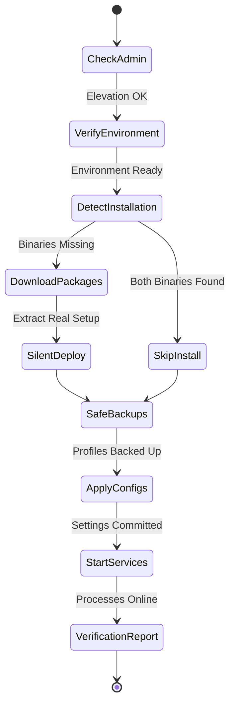

# Architecture & Technical Design

## 1. System Overview
ApexTuner orchestrates three interconnected subsystems in Windows:
1. **MSI Afterburner Engine:** Hardware monitoring, fan curve regulation, core/memory frequency offsets, and voltage-frequency (VFCurve) profile management.
2. **RivaTuner Statistics Server (RTSS):** Low-level Direct3D 9/11/12 and Vulkan SwapChain hooking, frametime tracking, and On-Screen Display (OSD) rendering via `HotkeyHandler.dll`.
3. **NVIDIA Display Driver (via NPI):** Profile-level driver overrides including pre-rendered frames, shader disk cache limits, and power management states.

---

## 2. Component Lifecycles & State Transitions

### A. Idempotent Bootstrap Flow

### B. Late-Injection vs Boot Hooking
* **Standard Operation:** RTSS registers a process creation hook (`SetWindowsHookEx` / AppInit mechanism). When any executable importing `dxgi.dll`, `d3d12.dll`, or `vulkan-1.dll` starts, `RTSSHooks64.dll` injects before the swapchain creation call (`CreateSwapChainForHwnd`).
* **Why "Launch on Hotkey" Crashes Games:** Injecting `RTSSHooks64.dll` after a game process has already initialized its DirectX 12 render loop requires hooking into an active `Present` pointer. Anti-cheats (BattlEye, Easy Anti-Cheat, Ricochet) flag late memory alteration as unauthorized DLL injection.
* **The ApexTuner Solution:** Keep RTSS running as a lightweight daemon (consumes 0% CPU and ~15 MB RAM) with `SingleTrayIconMode = 1` and `EnableOSD = 0`. The hook remains resident and verified by anti-cheat, while the user sees nothing on screen or in the tray until <kbd>Alt</kbd> + <kbd>1</kbd> is pressed.

---

## 3. Configuration Subsystem
All configuration state is managed as deterministic key-value text maps:
* `MSIAfterburner.cfg`: Primary configuration storing device polling intervals, hardware monitor masks, hotkey hex definitions, and GUI visibility modes.
* `Global`: RTSS master overlay template controlling base RGBA colors, coordinates, scaling modes, and default visibility state (`EnableOSD`).
* `HotkeyHandler.cfg`: Dedicated plugin mapping raw virtual key codes (`0x0004` = Alt, `0x0031` = '1') to internal toggle routines.
* `VEN_*.cfg`: Direct hardware profile linking PCI vendor (`10DE` = NVIDIA) and device IDs to specific CoreVoltageBoost, PowerLimit, and VFCurve matrices.
